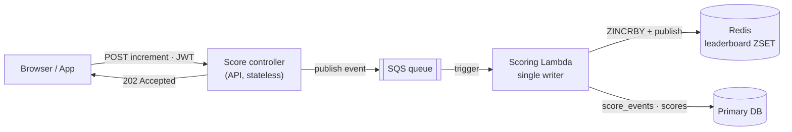
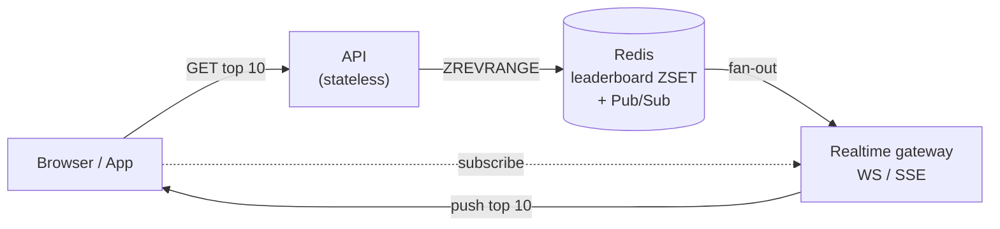
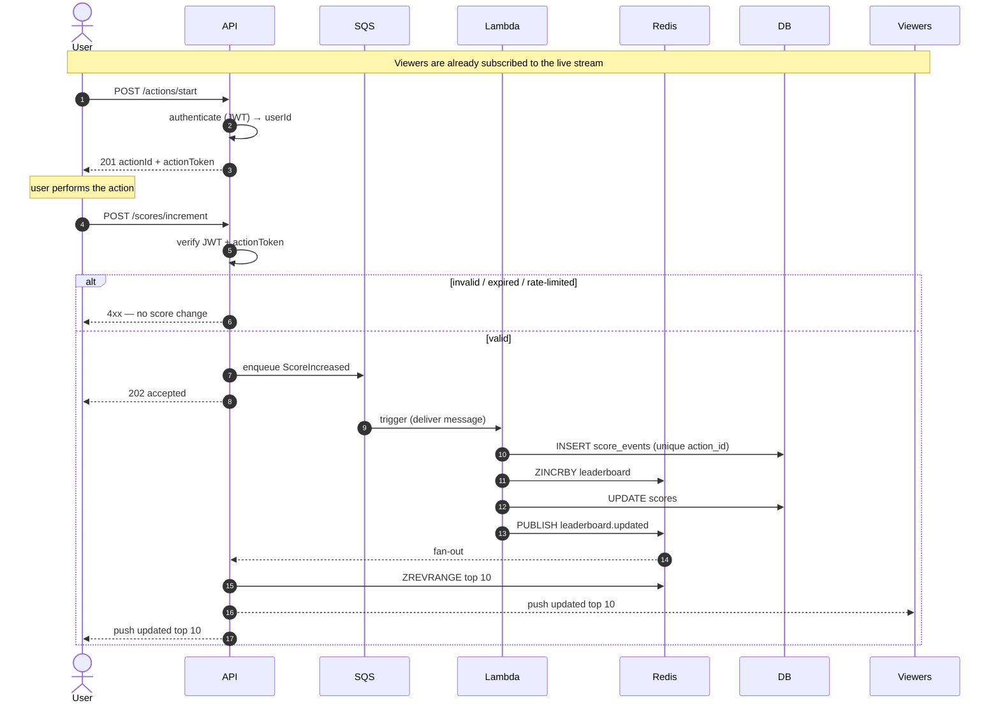

# Problem 6 — Scoreboard API Module (Specification)

Engineering specification for a **Scoreboard** module on the API service (backend application server). This document is written to be handed to a backend engineering team for implementation.

---

## 1. Overview

The module powers a scoreboard that shows the **top 10 users by score**. Users perform some action in the product; completing that action increases their score. The scoreboard must update **live** for all connected viewers.

The module is responsible for three things:

1. **Ingesting score increases** triggered by a completed user action — safely, so scores cannot be inflated by malicious or unauthorised callers.
2. **Serving the top-10 leaderboard** efficiently.
3. **Broadcasting live updates** to connected clients whenever the top 10 changes.

---

## 2. Scope

**In scope**

- REST endpoints to complete an action (increment score) and read the top 10.
- A realtime channel (WebSocket / SSE) that pushes leaderboard updates.
- Authentication, authorisation and anti-abuse controls.
- Data model, caching and scaling notes.

**Out of scope**

- The action itself and its business logic.
- User registration / identity provider (we assume an existing auth system that issues access tokens).
- Frontend implementation.

---

## 3. Terminology


| Term             | Meaning                                                                                               |
| ---------------- | ----------------------------------------------------------------------------------------------------- |
| **Action**       | Something a user completes in the product that earns score.                                           |
| **Action token** | A short-lived, single-use, server-signed token proving an action was legitimately started for a user. |
| **Score**        | A user's cumulative points.                                                                           |
| **Leaderboard**  | The ordered set of users by score; we expose the top 10.                                              |
| **Live update**  | A server push sent to clients when the top 10 changes.                                                |


---

## 4. Functional requirements


| #   | Requirement                                                                           |
| --- | ------------------------------------------------------------------------------------- |
| F1  | Return the current top 10 users (id, display name, score, rank).                      |
| F2  | Increase a user's score when they complete an action.                                 |
| F3  | Push a live update to subscribed clients when the top 10 changes.                     |
| F4  | Only the authenticated user can increase **their own** score.                         |
| F5  | A completed action may increase score **exactly once** (no replay / double counting). |
| F6  | Reject score increases that are not backed by a legitimately started action.          |


## 5. Non-functional requirements


| #   | Requirement                                                           |
| --- | --------------------------------------------------------------------- |
| N1  | `GET /scores/top` p99 latency < 50 ms (served from cache).            |
| N2  | Horizontally scalable: multiple API instances behind a load balancer. |
| N3  | Live updates delivered to clients within ~1 s of a score change.      |
| N4  | Correct leaderboard under concurrent increments (atomic updates).     |
| N5  | Abuse-resistant: rate limiting + authorisation + replay protection.   |
| N6  | Auditable: every score change is recorded for later investigation.    |


---

## 6. Architecture overview

The read and write paths are deliberately separated, so each is shown on its own.

**Write path** — a `POST` only drops a message on SQS; the Lambda does the work:




**Read & realtime path** — a `GET` reads Redis directly; updates are pushed live:




- The **API stays stateless**. On a write it only authenticates, validates, and **enqueues a `ScoreIncreased` message on SQS** — it never writes the leaderboard. On a read it queries Redis directly.
- **SQS triggers the Scoring Lambda**, the **single writer** of score state. Having one writer serialises updates, so concurrent increments can't race and each message is processed exactly once (with `UNIQUE(action_id)` as the backstop).
- The Lambda updates **Redis** (`ZINCRBY`) and the durable `score_events` / `scores` in the primary DB, then publishes `leaderboard.updated`.
- **Reads are unchanged**: `GET /scores/top` is served straight from the Redis `ZSET` (`ZREVRANGE 0 9`, `O(log n)`) — it never touches SQS or the Lambda.
- **Redis Pub/Sub** fans `leaderboard.updated` out to the realtime gateways, which push the new top 10 to their connected WebSocket/SSE clients.

---

## 7. Data model

`**users`** (owned by the identity system; referenced here)


| column       | type | notes              |
| ------------ | ---- | ------------------ |
| id           | uuid | primary key        |
| display_name | text | shown on the board |


`**scores**` (materialised current score — durable mirror of Redis)


| column     | type        | notes             |
| ---------- | ----------- | ----------------- |
| user_id    | uuid        | PK, FK → users.id |
| score      | bigint      | ≥ 0               |
| updated_at | timestamptz |                   |


`**score_events**` (append-only audit log — one row per accepted increment)


| column     | type        | notes                                               |
| ---------- | ----------- | --------------------------------------------------- |
| id         | uuid        | PK                                                  |
| user_id    | uuid        | FK → users.id                                       |
| action_id  | uuid        | **unique** — this is what makes a replay impossible |
| points     | int         | points awarded for this action                      |
| created_at | timestamptz |                                                     |


The `UNIQUE(action_id)` constraint is the backstop that makes replays impossible even under races: a duplicate completion fails the insert.

**Redis**

- `leaderboard` — `ZSET` of `user_id → score`.
- `action:token:<jti>` — optional marker for single-use action tokens (TTL).

---

## 8. API specification

Base URL: `/api/v1`. All endpoints require `Authorization: Bearer <JWT>` unless noted. All responses are JSON.

### 8.1 Start an action (issue an action token)

```
POST /api/v1/actions/start
```

Called when the user begins the score-earning action. The server issues a short-lived, single-use **action token** bound to the user.

**Response `201`**

```jsonc
{
  "actionId": "a1b2c3…",
  "actionToken": "<signed JWT, exp ~2 min>"
}
```

### 8.2 Complete an action (increase score)

```
POST /api/v1/scores/increment
```

**Request body**

```jsonc
{
  "actionId": "a1b2c3…",
  "actionToken": "<the token from /actions/start>"
}
```

**Behaviour**

The API handles the request synchronously only up to validation, then hands the work off asynchronously:

1. Verify the caller's JWT → `userId`.
2. Verify `actionToken`: valid signature, not expired, `sub === userId`, `actionId` matches.
3. Enqueue a `ScoreIncreased` message `{ actionId, userId, points, occurredAt }` on the SQS queue.
4. Return `202 Accepted` — the leaderboard updates a moment later.

The **Scoring Lambda** then consumes the event and is the **only** writer of score state:

- `INSERT` into `score_events` with `UNIQUE(action_id)` → duplicates are ignored (exactly-once).
- `ZINCRBY leaderboard <points> <userId>` and update `scores`.
- If the top 10 changed, `PUBLISH leaderboard.updated` for realtime fan-out.

**Response `202`**

```jsonc
{ "actionId": "a1b2c3…", "status": "accepted" }
```

**Errors**: 

- `401` unauthenticated
- `403` token/user mismatch
- `422` invalid/expired token
- `429` rate limited.

### 8.3 Get the top 10

```
GET /api/v1/scores/top?limit=10
```

Public or authenticated (configurable). Served from the Redis `ZSET`.

**Response `200`**

```jsonc
{
  "updatedAt": "2025-01-01T00:00:00.000Z",
  "leaderboard": [
    { "rank": 1, "userId": "…", "displayName": "Ada", "score": 4820 }
  ]
}
```

### 8.4 Live updates

```
GET /api/v1/scores/stream        # Server-Sent Events (text/event-stream)
# or
WS  /api/v1/scores/stream        # WebSocket
```

On connect, the server sends the current top 10, then pushes a new snapshot whenever `leaderboard.updated` fires.

**Event payload** (the same shape as the top-10 response above):

```jsonc
event: leaderboard
data: { "updatedAt": "…", "leaderboard": [ … ] }
```

## 9. Execution flow (end-to-end)




> Reads (`GET /scores/top`) are not shown — they go straight to the Redis `ZSET`
> and never touch the bus or the Lambda.

---

## 10. Error handling


| Status | When                                                         |
| ------ | ------------------------------------------------------------ |
| `400`  | Malformed request body.                                      |
| `401`  | Missing / invalid access token.                              |
| `403`  | Token user ≠ action token subject.                           |
| `422`  | Invalid or expired action token.                             |
| `429`  | Rate limit exceeded.                                         |
| `500`  | Unexpected server error (logged, generic message to client). |


All errors share a consistent shape: `{ "error": string, "details"?: unknown }`.